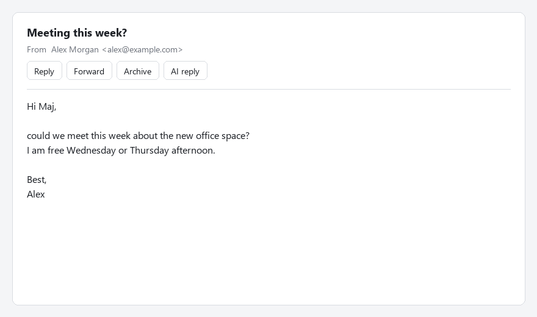

# AI reply for Thunderbird

A Thunderbird button that drafts a reply to the open mail with [Claude Code](https://docs.claude.com/en/docs/claude-code) running on your own machine. The reply window opens right away and the text streams in while the model writes, so you can keep working.

It is for people who answer a lot of mail and want a first draft that already sounds like them. You open a mail, click the button, and edit instead of starting from a blank window. Nothing is ever sent. You read the draft, fix it and press Send yourself.

## It uses your Claude credits

There is no free model behind this. Every reply runs `claude -p` with the account your Claude Code CLI is logged into, so it counts against your Claude plan limits or your API credits, the same as any other Claude Code session. Rough numbers from testing: a quick reply is about $0.03, a deep reply about $0.20 at API prices. The exact cost of each reply is written to `host/host.log`.

## Two modes

* **Quick reply:** a fast model (Sonnet by default) that sees only the open mail. Text starts in about 7 seconds, cost is a few cents.
* **Deep reply:** a stronger model (Opus by default) that can first read your earlier mails with that person and search a notes folder you point it to. Slower, roughly 30 seconds, and costs more.

Both modes can follow your own writing guide, so the reply sounds like you and not like a chatbot. You can also type a short instruction in the popup, for example "say yes, Thursday at 3pm".

## How it works

The add-on talks to a small Node script through Thunderbird's native messaging. The script runs `claude -p` with your settings and streams the text back into the compose window. There is no API key in the add-on, it uses whatever account your Claude Code CLI is logged into.

## Requirements

* Thunderbird 128 or newer
* Node.js 18 or newer
* Claude Code CLI installed and logged in (`claude` works in a terminal)

## Install

1. Clone this repo somewhere it can stay. The host is registered at this path.
2. Run the installer:
   * Windows: `powershell -ExecutionPolicy Bypass -File install.ps1`
   * macOS or Linux: `./install.sh`
3. In Thunderbird open Add-ons and Themes, click the gear icon, pick Install Add-on From File and choose `dist/ai-reply.xpi`.
4. Open any mail. The AI reply button sits in the message header next to Reply and Forward.

## Configuration

The installer creates `host/config.json` from `host/config.example.json`. It is gitignored, so your paths stay private.

| Key | What it does |
| --- | --- |
| `claude` | Path to the Claude Code CLI. `claude` works if it is on your PATH. |
| `styleFile` | A Markdown file with your writing guide. It is added to the system prompt in both modes. |
| `contextDir` | Folder with your notes (an Obsidian vault works well). Deep mode can read and search it. |
| `mcpConfig` | MCP config with a Thunderbird server, so deep mode can read earlier mails. See `host/mcp.example.json`. |
| `quickModel`, `deepModel` | Model names passed to `claude --model`. |
| `timeoutMinutes` | When to give up on a reply. |

For reading earlier mails, deep mode works with [thunderbird-mcp](https://github.com/TKasperczyk/thunderbird-mcp). Without it deep mode still works with your notes folder only.

## Privacy and safety

* The open mail is sent to Anthropic through your Claude Code account. In deep mode so are the earlier mails and notes it decides to read.
* Mail content is treated as untrusted. Deep mode only gets read only tools (Read, Grep, Glob and the Thunderbird search tools), it cannot edit files, run commands or send anything.
* Requests and costs are logged to `host/host.log` on your machine.

## Known limits

* While the text is streaming, the compose body is rewritten every few hundred milliseconds. Wait until it stops before you edit.
* The reply goes above the quoted original. With a signature placed above the quote, the AI text lands above the signature.
* Tested on Windows with Thunderbird 153 ESR. The macOS and Linux installer is written but not tested yet.

## License

[GPL-3.0](LICENSE). You can use, change and share this freely. If you distribute a modified version, you have to publish its source under the same license.
